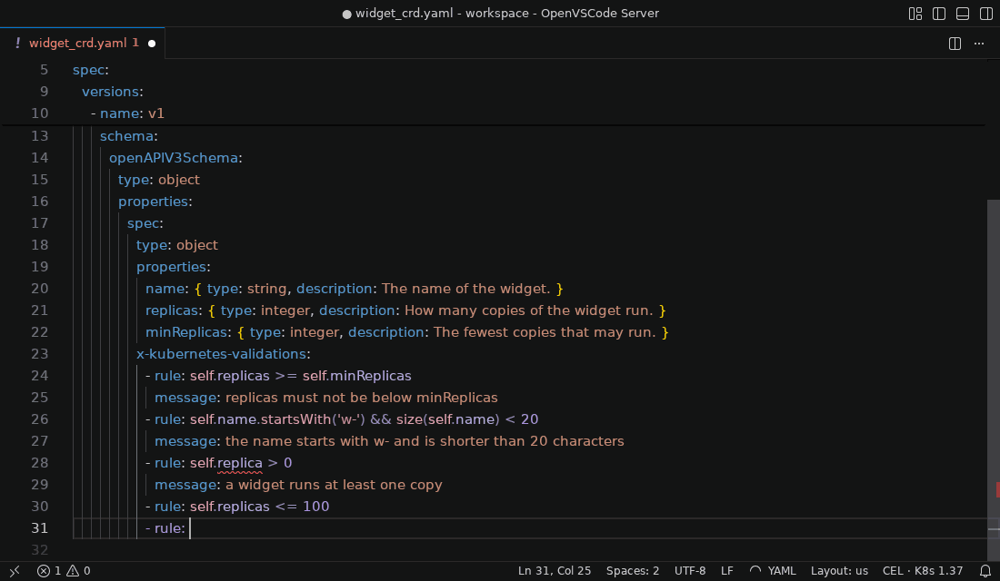
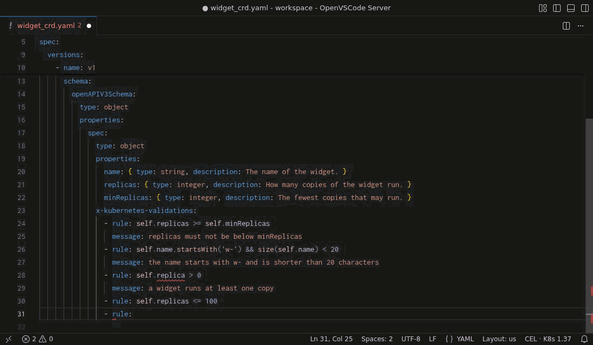

# cel-lens

Language support for CEL in Kubernetes YAML: errors, hover, completion and quick fixes that match the API server.

## Install

- **VS Code:** download the `.vsix` for your platform from the [releases](https://github.com/JairJosafath/cel-lens/releases), then run **Extensions: Install from VSIX...** or `code --install-extension <file>.vsix`. The extension carries the engine; nothing else to set up.
- **Command line:** `go install github.com/JairJosafath/cel-lens/engine@<version>` installs the engine; see [engine/](engine/) for the details.

## Features

Stable:

| Feature                           | What it does                                         |
| --------------------------------- | ---------------------------------------------------- |
| Problems                          | CEL errors on the exact part that is wrong           |
| Hover, completion and quick fixes | Types, fields and fixes for CEL in Kubernetes YAML   |
| Colors                            | The parts of a CEL expression, in the style you pick |
| Kubernetes version                | Results match the version you choose                 |

Experimental, off until you list its name in the `cel-lens.experimental` setting:

| Name | What it does                                       |
| ---- | -------------------------------------------------- |
| none | No experimental feature is offered in this release |

## Learn more

- [engine/](engine/): the CEL engine and command line.
- [vscode/](vscode/): the VS Code extension.
- [CONTRIBUTING.md](CONTRIBUTING.md): how to contribute.
- [SECURITY.md](SECURITY.md): how to report a vulnerability.
