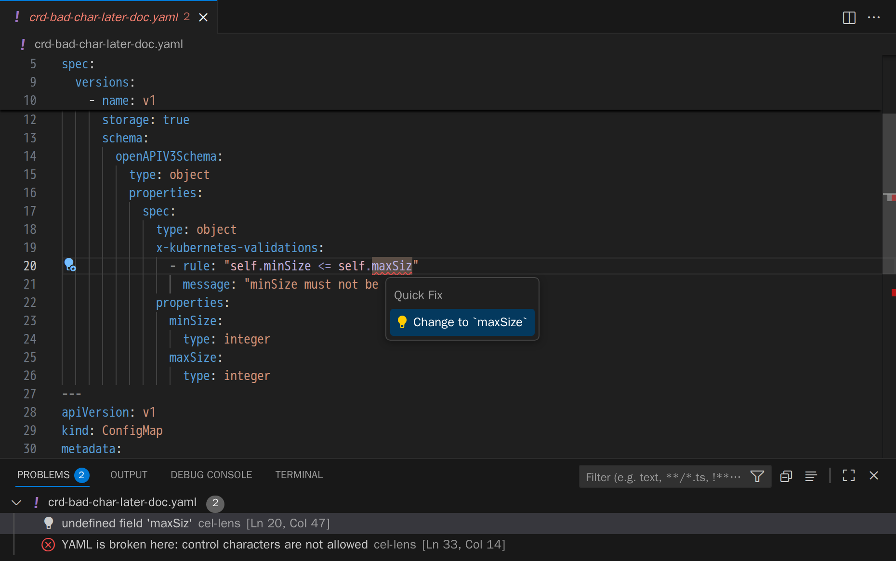
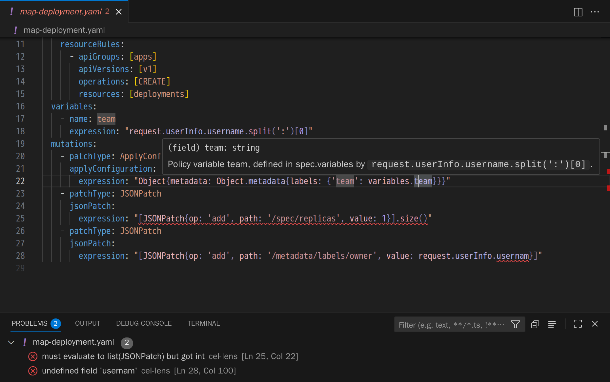
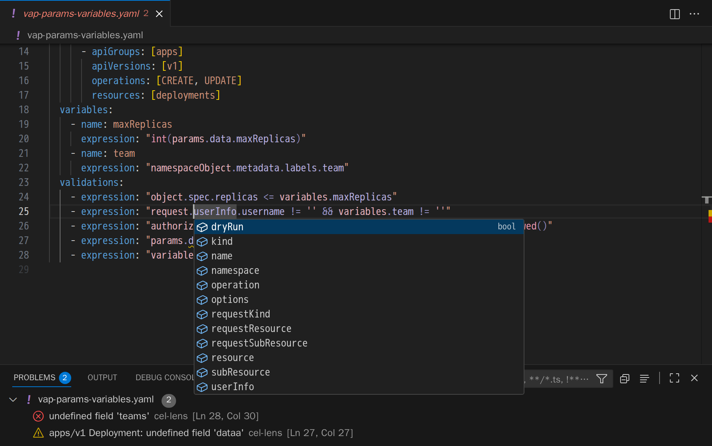

# cel-lens

cel-lens checks the CEL expressions in your Kubernetes YAML the way the API server does,
so you find a broken rule in your editor before it reaches a cluster.

\
*A misspelled field in a CRD validation rule, with a quick fix.*

\
*Errors and a typed hover in a MutatingAdmissionPolicy.*

\
*Completion of `request` fields in a ValidatingAdmissionPolicy.*

## Install in VS Code

1. Download the `.vsix` for your platform (`linux`, `darwin` or `win32`; `x64` or `arm64`)
   from the latest `vscode-v…` release on [Releases](https://github.com/JairJosafath/cel-lens/releases).
2. Run `code --install-extension cel-lens-vscode-<platform>-<version>.vsix`, or
   **Extensions: Install from VSIX...** in the Command Palette.

The engine is inside the `.vsix`, so there is nothing else to install.

## Command line and other editors

The engine, `cel-lens-core`, runs as `cel-lens-core check <paths>` in a terminal or CI, and as
a language server (`cel-lens-core lsp`) for any editor. [engine/README.md](engine/README.md) shows how to install it.

## What it checks

- CRD `x-kubernetes-validations` rules
- ValidatingAdmissionPolicy and MutatingAdmissionPolicy expressions
- Kyverno `ValidatingPolicy` (`policies.kyverno.io/v1`)

Errors use the API server's own messages, from cel-go and the Kubernetes CEL libraries.
In VS Code you also get hover, completion, quick fixes and colors for CEL.

## Issues

Development is paused for now, but bug reports and ideas are welcome at
<https://github.com/JairJosafath/cel-lens/issues>.

## License

Apache-2.0; see [LICENSE](LICENSE).
