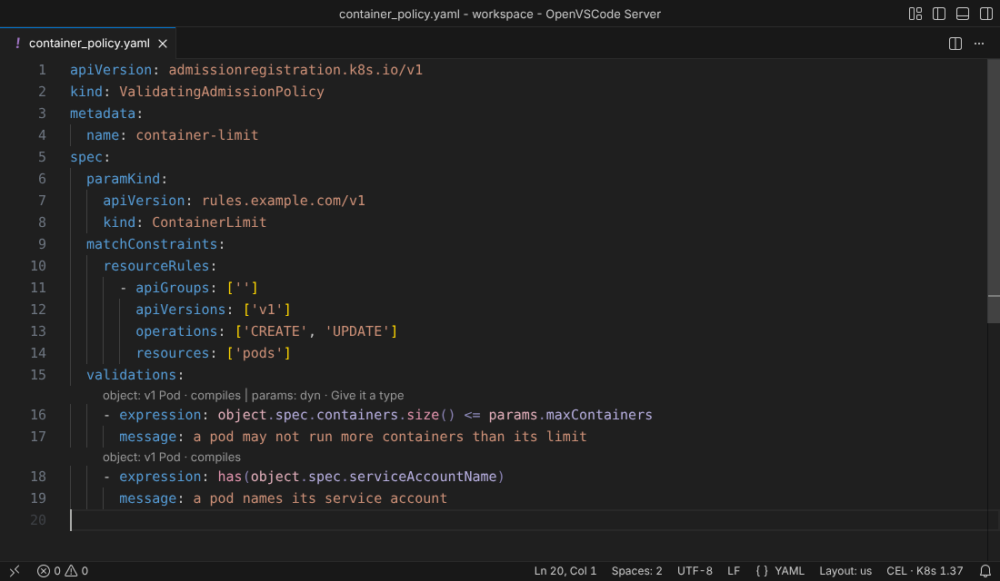
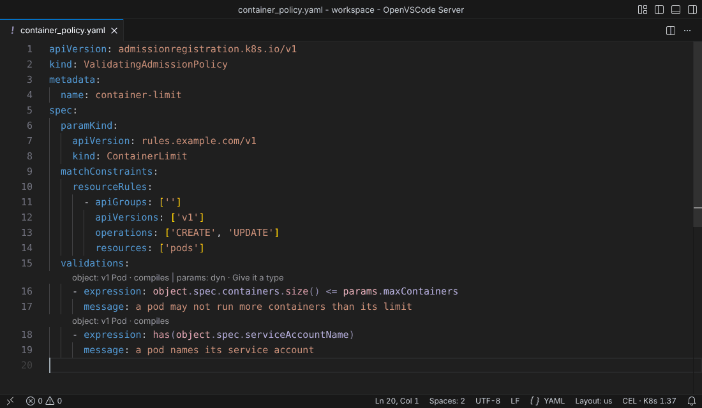
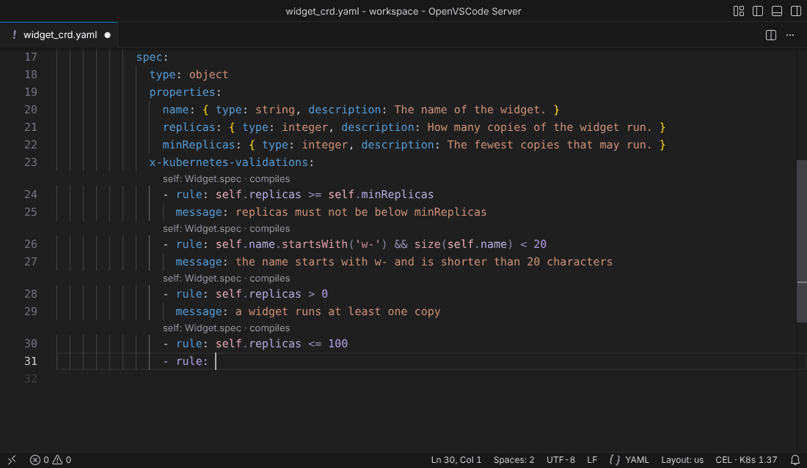
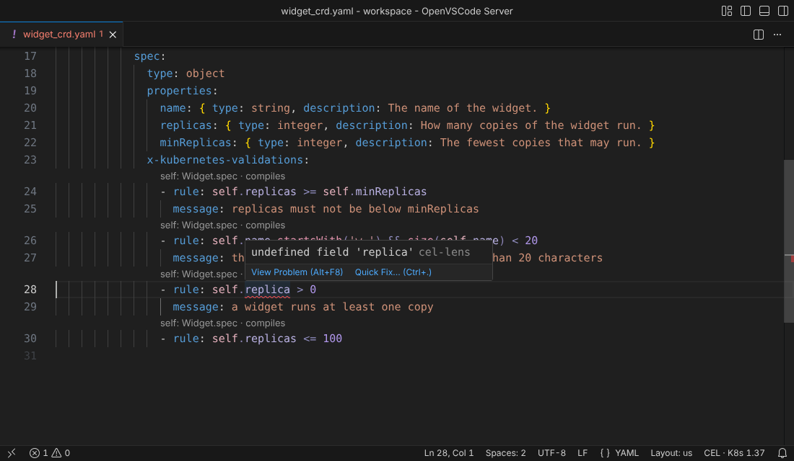
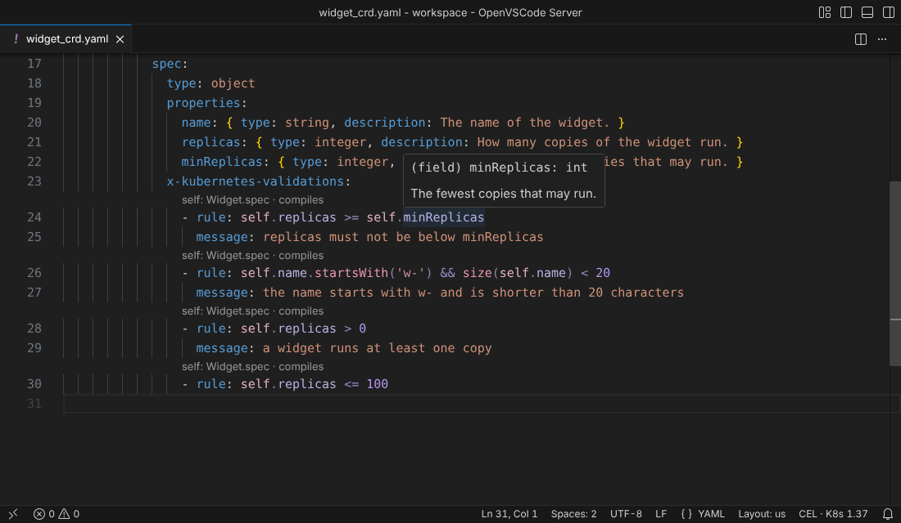
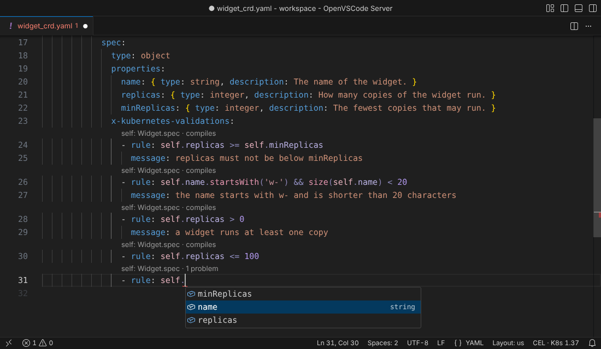
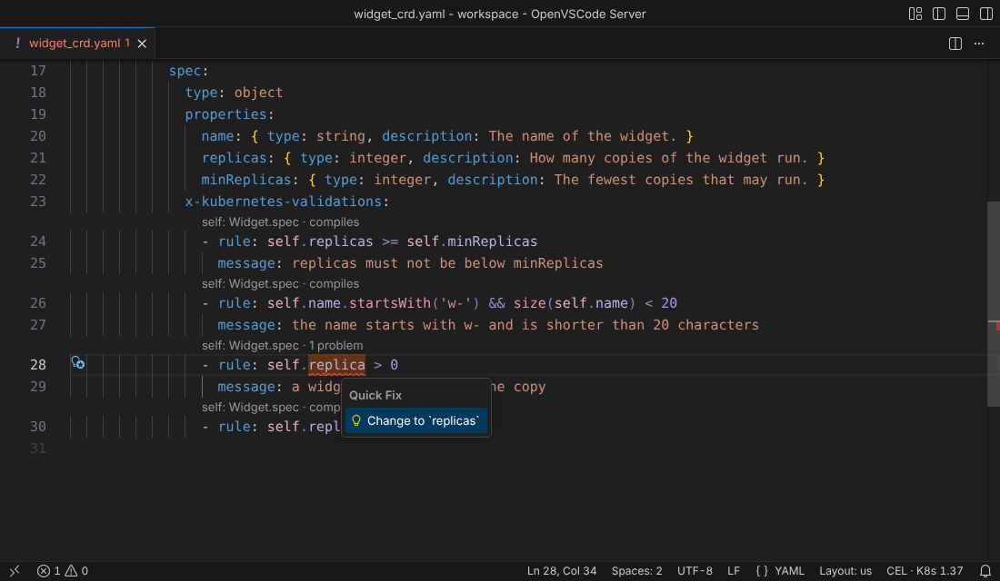
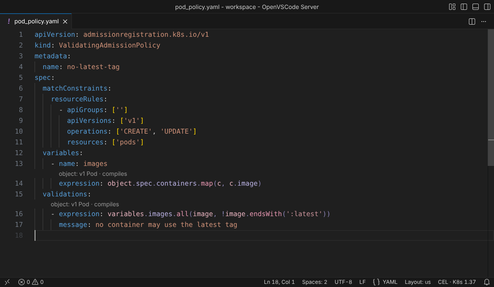
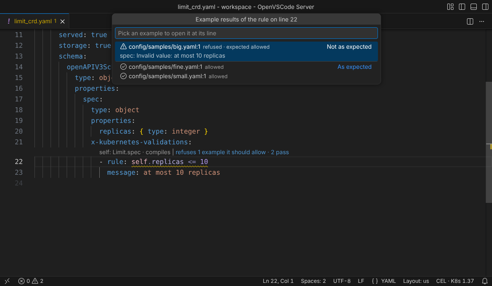

# cel-lens for VS Code

Shows CEL errors, hover, completion, quick fixes and colors inside Kubernetes YAML.

## What it looks like

The line above each CEL rule: what `self` (or a policy's `object`) is, whether the rule compiles, and the values it reads as `dyn`. Click the first part to open the rule's first problem in the problems peek, or its hover when it has none; a part whose type comes from `.cellens`, such as `variables.limit: int`, opens that entry beside the rule. Click **+N more** to pick from the values the line leaves out. **cel-lens: Toggle Inline Info** turns the line off and on.

Click **Give it a type** on the line above a rule to give a `dyn` value a type: write a schema or a short type in `.cellens`, opened beside the rule, or pick a Go type of the workspace, a built-in kind or a kind of the workspace's CRDs.

A CEL rule colored part by part as it is typed in a CRD.

The list after typing `self.` and one item picked.

A red squiggle under the part of a CEL rule that is wrong, with the reason.

The type and description of a field in a CEL rule.

The fields of the schema offered after typing `self.`.

The fix offered on a problem in a CEL rule.

The parts of the CEL expressions of an admission policy in different colors.

## Install

The only way to install today is the `.vsix` from the GitHub releases of JairJosafath/cel-lens:

1. Open <https://github.com/JairJosafath/cel-lens/releases> and pick the release `vscode-vX.Y.Z` you want.
2. Download the `.vsix` for your platform (one file per platform).
3. Run **Extensions: Install from VSIX...** in the Command Palette, or `code --install-extension <file>.vsix`.

The extension carries the cel-lens engine for your platform, so there is nothing else to install or set up.

## Give a value a type

Where Kubernetes gives a CEL value no type, it is `dyn`, and cel-lens can't check, complete or explain it: an `x-kubernetes-int-or-string` field to a CRD's rule, or the `params` of a policy whose `paramKind` is a custom kind. A `.cellens` file says what such a value is; commit it, so everyone gets the same types. cel-lens writes it with you:

1. On the line above the rule, click **Give it a type** after the value (such as `params: dyn · Give it a type`), or **+N more** and then the value. Or run **cel-lens: Give a Value a Type…** and pick one of the values of the open file.
2. The picker is titled after the value, such as **Give params a type**. It opens at once and lists the Go types, examples and kinds as the engine finds them. Pick one of the forms below.
3. The entry goes in the nearest `.cellens` at or above the file, or a new one at the root of its workspace folder, and the rules are checked again with the type. A type written at once (a Go type, a kind, `int` or `string`, or one from an example), or removed, is saved when the `.cellens` the line names had no unsaved edits and nothing but that write changed it; when the engine writes another `.cellens`, nothing is saved. What you write in `.cellens` is yours to save.

A schema or a short type is written in `.cellens` itself: cel-lens adds the entry and opens `.cellens` beside the rule (in the editor group that already shows it, if one does), with the cursor where the type goes. There you have the engine's completion, hover and problems as you type, and the line above the rule follows each change.

### A schema

<!-- Picture to take: images/give-type-schema.png, `.cellens` open beside a ValidatingAdmissionPolicy after Write a schema in .cellens…, in a dark theme: the new entry's `schema:` with `type: object` and `properties: {maxReplicas: {type: integer}}` half typed and the completion of its keywords open, and on the left `params: {maxReplicas} · Edit` above the rule. -->

Pick **Write a schema in .cellens…** to describe the value as an OpenAPI schema, as a CRD's `openAPIV3Schema` does: properties, descriptions, formats and the `x-kubernetes-` extensions. The entry starts as `schema:` with `type: object` and `properties: {}`, the cursor between the braces.

### A Go type

<!-- Picture to take: images/give-type-go.png, the picker of Go types after Use a Go type…, in a dark theme: `quota` typed in the filter, and `QuotaSpec` with its folder `api/v1` and its doc comment `QuotaSpec is the quota of a team.` highlighted. -->

Pick **Use a Go type…** when the value is a struct of the workspace's Go code, such as a kubebuilder API type. A second picker lists the exported structs with a `json` tag of the workspace folder of the `.cellens`, each with its folder and the first sentence of its doc comment, found by any of them as you type; it starts with what you typed in the first picker, and its **Back** button returns to the first. The entry is written at once, as `go: ./api/v1#QuotaSpec`, and follows the Go code from then on.

### A short type

<!-- Picture to take: images/give-type-short.png, `.cellens` open beside a ValidatingAdmissionPolicy after Write a short type in .cellens…, in a dark theme: the new entry's `type: "{name: string, replicas: int}"` being typed with the completion of the type names open, and on the left the line above the rule showing `params: {name, replicas} · Edit`. -->

Pick **Write a short type in .cellens…** for a CEL type that needs nothing more, such as `int` or `{name: string, replicas: int}`. The entry starts as `type: "{}"`, the cursor between the braces.

### An example

<!-- Picture to take: images/give-type-example.png, the picker titled `Give params a type` in a dark theme, opened from `params: dyn · Give it a type` above a rule of a ValidatingAdmissionPolicy whose paramKind is ReplicaLimit: `Examples in the workspace` with `config/samples/limit.yaml`, `rules.example.com/v1 ReplicaLimit` and `Document at line 1`, then `Paste an example…`. -->

Under **Examples in the workspace**, the picker lists the documents of the workspace of the value's kind, such as the samples in `config/samples/` for a policy's `params`, each by its file (with its workspace folder in a multi-root workspace), its kind and the line it starts at. Pick one, and cel-lens works out an OpenAPI schema from it (from the value's own part of it, such as its `spec.config`), writes it as the entry's `schema:` and opens `.cellens` beside the rule at the entry, for you to refine. What the example leaves open, such as the items of an empty list or a field that is a number in one document and a string in another, shows once as an information problem at its key in `.cellens`; it goes when you edit there.

<!-- Picture to take: images/give-type-paste.png, the editor `Example of params.yaml` beside a ValidatingAdmissionPolicy after Paste an example…, in a dark theme: `Use this example as the type` above the comment `# An example of params`, a ReplicaLimit pasted below it, and the check icon in the editor title. -->

Or pick **Paste an example…**: an editor opens beside the rule, named after the value, such as **Example of params.yaml**, with a comment that says what to paste. Paste an example of the value there, or a whole resource of its kind that holds it (cel-lens then takes the value's part of it; a resource of another kind, such as an object reference, is the value itself, which the engine tells from the value's kinds and says in a note; when it does not know them, a paste with `apiVersion` and `kind` at its root is read as a resource, and as the value itself when it has no value at the value's path), YAML or JSON, one document or several, and click **Use this example as the type** above it, or the check in its editor title: cel-lens does the same as for a document of the workspace, and closes the editor. cel-lens keeps the example in memory, so closing its editor never asks to save, and closing it yourself writes nothing. After a window reload, the examples of the window before are closed. When the engine cannot read the example, the reason shows once and the editor stays open, to fix it; an example over 1 MiB, the most the engine reads, is refused at once.

### A kind

<!-- Picture to take: images/give-type-kind.png, the picker titled `Give params a type` in a dark theme with `deploy` typed in the filter and `Deployment`, `apps/v1`, highlighted under Built-in kinds. -->

Type to find a built-in kind, such as `deploy` for Deployment, or a kind of the workspace's CRDs (listed with the `crd-typed-policies` experimental feature on), and pick it: the entry is written at once, as `kind: apps/v1 Deployment`.

### A value of a CRD

A value of a CRD takes an int or a string: its picker offers `int` and `string` only, written at once. A schema, a short type, a Go type or a kind would not fit it.

### Edit or remove a type

**Edit** opens the same picker on what the value has. The schema and short type lines open `.cellens` at its entry, with the cursor on the type it has; a Go type, a kind, `int` or `string` replaces it at once. **Remove** removes the entry at once. The engine changes `.cellens` in the editor, so **Undo** in the `.cellens` editor takes a change back.

## Example results

While you edit a rule in a CRD's `x-kubernetes-validations`, cel-lens runs it on the example objects you keep next to it, with the API server's own validator, and says what the rule does to each one. There is no cluster and nothing to register: a kubebuilder project's `config/samples/` is found as it is, and so is a `testdata/` folder.

The line above a rule that refuses one of its three examples, which expects to be allowed: `refuses 1 example it should allow · 2 pass`, and the warning on the rule.

The picker the part opens, titled after the rule's line: `big.yaml` first, with the API server's message, then the two examples that pass.

### Where the examples come from

An example is any YAML document of the workspace whose `apiVersion` and `kind` are a version the CRD serves (its group, a version with `served: true`, and its kind). The documents are found as the examples under **Examples in the workspace** of **Give it a type** are: hidden folders, `node_modules`, files over 1 MiB and what a symbolic link leads out of the folder are skipped, a file you have open counts with the text in the editor, and a CRD has at most 100 examples. A document in the CRD's own file is none of its examples.

### What an example expects

An example is expected to be allowed. It says it expects to be refused in one of two ways:

- by its path: a folder of it below its workspace folder, or a word of its file name (split at `-`, `_` and `.`), is `invalid`, `bad`, `refused`, `rejected` or `denied`, as in `testdata/invalid/big.yaml` or `config/samples/widget-bad.yaml`;
- by a comment above the document's first key, which wins over the path: `# cel-lens: refused`, `# cel-lens: refused "at most 10"` to say the refusal must have that part of its message, or `# cel-lens: allowed`.

An example that expects to be refused is right when the schema or at least one rule refuses it, with the message when it gives one. So a rule that refuses a refused example is quiet, and a rule that refuses an example that expects to be allowed is wrong, at that rule.

### Updates

The same object twice in one file is an update: the first document is created, the next is an update from it, as `kubectl apply -f` of the file does. A rule that reads `oldSelf` runs on the update, with the first object as its `oldSelf`; with no such pair in the examples, its line says `not run: needs an update example`.

### The line above the rule

A rule with examples gets a last part on the line above it, quiet when all is well: `3 examples pass`. When a rule gets an example wrong, the wrong verdicts come first: `refuses 1 example it should allow · 2 pass`, `refuses 1 example with another message`, `allows 1 example it should refuse` or `1 example errors`. A rule that runs on none says why: `not run: CRD refused`, `not run: needs an update example`, `not run: field absent from the examples`. The line keeps its width: the part shortens to `1 wrong · 2 pass` before the values do.

Click the part to open the examples in a picker, titled after the rule's line: the examples that are not as expected first, then the others, each with its verdict (`refused · expected allowed`, `allowed · as an update`), its file and line, and the API server's message. The picker opens at once and says the results are being computed until the engine answers. Pick an example and it opens at its line beside the rule.

### The hover and the warnings

The rule's hover gains a section with the same words and the examples, each linked to its file and line: the wrong verdicts first, then the errors, then the others, at most ten and then `and N more`. A wrong verdict is also a warning, so it shows in the Problems view and at both ends: on the rule (`refuses config/samples/big.yaml:3, which expects to be allowed: ...`) and on the example (`expected to be allowed, but the rule "self.replicas <= 10" refuses it: ...`, or `expected to be refused, but nothing refuses it`). They are warnings and not errors: the API server would accept the CRD, and it is the example that disagrees. The schema's own problems on an example, such as `unknown field "spec.extra"`, are errors on the example.

### Turn it off

**cel-lens: Toggle Example Results** turns all of it off and on: the part, the hover's section, the warnings, and the check of the examples itself, so nothing about the examples is read or run while it is off. The status bar menu shows **Example results: on** or **off** and flips it. Open editors follow at once, without a reload. It flips the setting `cel-lens.exampleResults` at the scope that sets it for the open file, or in your user settings. With it off, clicking a part that is still there says so and offers a button to turn it on. In a workspace of several folders the engine has one switch: while any folder has the results on, the hover and the warnings of a folder that turns them off stay, but its part is hidden and its picker says they are off.

Rules of a ValidatingAdmissionPolicy have no example results yet.

## Commands

The Command Palette lists the commands under **cel-lens**: **cel-lens: Show Logs** on any file, the others on YAML files, and **cel-lens: Use This Example as the Type** only on the editor of a pasted example. None has a keybinding.

| Command                                    | What it does                                                                                                               |
| ------------------------------------------ | -------------------------------------------------------------------------------------------------------------------------- |
| **cel-lens: Give a Value a Type…**         | Lists the values the rules of the open file read as `dyn` or with a type from `.cellens`, and gives the one picked a type. |
| **cel-lens: Use This Example as the Type** | On the editor **Paste an example…** opens: gives the value the schema worked out from the example in it.                   |
| **cel-lens: Toggle Inline Info**           | Turns the line above each CEL rule off and on.                                                                             |
| **cel-lens: Toggle Example Results**       | Turns what each CRD rule does to its example objects off and on: the part of the line, the hover, the warnings.            |
| **cel-lens: Choose Color Style**           | Picks how CEL is colored: CEL, Classic or Off.                                                                             |
| **cel-lens: Pick Kubernetes Version**      | Picks the Kubernetes version the results match.                                                                            |
| **cel-lens: Show Actions**                 | Opens the status bar menu.                                                                                                 |
| **cel-lens: Restart Engine**               | Restarts the engine, such as after changing `cel-lens.serverPath`.                                                         |
| **cel-lens: Show Logs**                    | Opens the **cel-lens** output channel.                                                                                     |

## Settings

| Setting                      | Default | What it does                                                                                                                                                                                                                                                                                                                                                                                                                                                                                                                                                                                                          |
| ---------------------------- | ------- | --------------------------------------------------------------------------------------------------------------------------------------------------------------------------------------------------------------------------------------------------------------------------------------------------------------------------------------------------------------------------------------------------------------------------------------------------------------------------------------------------------------------------------------------------------------------------------------------------------------------- |
| `cel-lens.colorStyle`        | `cel`   | `cel`, `classic` or `off`: the color style of the parts of a CEL expression. Change it with **cel-lens: Choose Color Style** or the status bar menu. Resource scope: user, workspace or workspace folder.                                                                                                                                                                                                                                                                                                                                                                                                             |
| `cel-lens.inlineInfo`        | `true`  | Shows a line above each CEL rule: what `self` (or a policy's `object`) is, whether the rule compiles or how many problems it has, and the values it reads as `dyn`. Turn it off and on with **cel-lens: Toggle Inline Info** or the status bar menu, which shows **Inline info: on** or **off**; open editors follow at once. The toggle writes the scope that sets the value in force for the open file, or your user settings. Resource scope: user, workspace or workspace folder.                                                                                                                                 |
| `cel-lens.exampleResults`    | `true`  | Shows what each rule of a CRD does to the example objects of the workspace: a part of the line above the rule (`3 examples pass`), a section of its hover and a warning for each wrong verdict; see [Example results](#example-results). Off, the engine reads, checks and runs no example. Turn it off and on with **cel-lens: Toggle Example Results** or the status bar menu, which shows **Example results: on** or **off**; open editors follow at once. The toggle writes the scope that sets the value in force for the open file, or your user settings. Resource scope: user, workspace or workspace folder. |
| `cel-lens.kubernetesVersion` | `""`    | Advanced: the Kubernetes version the results match, such as `1.36`. Empty means the engine's default. The status bar shows the version the engine uses; one it refuses is logged and the engine keeps its default. May restart the engine.                                                                                                                                                                                                                                                                                                                                                                            |
| `cel-lens.experimental`      | `[]`    | Advanced: the experimental features to turn on, from `kyverno`, `crd-typed-policies` and `fitting-completion`. Empty means none; see [Experimental features](#experimental-features). A name the engine does not know is ignored and reported once in a notification with a button to the setting; a misspelt name gets a suggestion of the closest known one, and when every unknown name has one, a Replace button rewrites those names in the setting at the scope that set them.                                                                                                                                  |
| `cel-lens.trace.server`      | `off`   | `off`, `messages` or `verbose`: traces the protocol in the **cel-lens** output channel.                                                                                                                                                                                                                                                                                                                                                                                                                                                                                                                               |
| `cel-lens.serverPath`        | `""`    | Advanced: a `cel-lens-core` binary to use instead of the bundled engine. Empty (the default) uses the bundled one. Machine scope: in a remote window (WSL, SSH, a dev container) set it on the Remote tab of Settings.                                                                                                                                                                                                                                                                                                                                                                                                |

## Supported Kubernetes versions

The bundled engine matches the API server's CEL environment of these Kubernetes versions:
`1.33`, `1.34`, `1.35`, `1.36` and `1.37`. The default is `1.37`. To pick another, run **cel-lens: Pick Kubernetes Version** or open the status bar menu.

## Experimental features

Every feature is stable or experimental. A stable feature is always on. An experimental feature is off until you list its name in the `cel-lens.experimental` setting.

Stable:

| Feature                                          | What it does                                                                                                                    |
| ------------------------------------------------ | ------------------------------------------------------------------------------------------------------------------------------- |
| Checks of CEL                                    | Compiles the CEL of `x-kubernetes-validations`, ValidatingAdmissionPolicy and MutatingAdmissionPolicy like the API server       |
| Language server                                  | Diagnostics, hover, completion and quick fixes                                                                                  |
| Kubernetes version                               | Results match the version in `cel-lens.kubernetesVersion`                                                                       |
| Typed `object`, `oldObject` and policy variables | Typed from the built-in kinds a policy matches                                                                                  |
| Typed `params` of a built-in kind                | Typed from `spec.paramKind` when it names a built-in kind                                                                       |
| Colors                                           | Colors the parts of CEL in the style of `cel-lens.colorStyle`; a Kyverno policy only with the `kyverno` experimental feature on |

Experimental:

| Name                 | What it does                                                                                                                                                                                                                   | Why it is experimental                                                                                                                                                                                                                                                                                                                                                                                                                                                                        |
| -------------------- | ------------------------------------------------------------------------------------------------------------------------------------------------------------------------------------------------------------------------------ | --------------------------------------------------------------------------------------------------------------------------------------------------------------------------------------------------------------------------------------------------------------------------------------------------------------------------------------------------------------------------------------------------------------------------------------------------------------------------------------------- |
| `kyverno`            | Checks, hover and completion for Kyverno `ValidatingPolicy` (`policies.kyverno.io/v1`). Off, these documents are parsed but get no diagnostic, hover or completion. On, the extension colors these documents; off, it does not | Compiled with Kyverno's compiler but never run against Kyverno's engine; only `ValidatingPolicy` is read                                                                                                                                                                                                                                                                                                                                                                                      |
| `crd-typed-policies` | Types `params` of a custom resource, and `object` and `oldObject` of a policy that matches one, from a CustomResourceDefinition found in the workspace. Off, they are `dyn` and hover says the feature is off                  | The workspace scan runs only while the feature is on, at initialize or when the setting turns it on. It runs in the background and open documents are checked again when it ends. It reads at most 20000 YAML files and skips files over 1 MiB, so a CRD past either limit leaves its type `dyn`; the engine warns once at the file cap; a single skipped file is logged on its own line, and many are reported in one summary log line with their count, the limit and the first three names |
| `fitting-completion` | After a dot completion offers only what the receiver has, before a dot only the names of this kind of document, and hover says why a value is `dyn`. Off, completion and hover behave as in v0.17.1                            | Built after v0.17.1 of the engine and not yet proven on real use                                                                                                                                                                                                                                                                                                                                                                                                                              |

Kyverno `ValidatingPolicy` documents are colored only with `kyverno` in `cel-lens.experimental`; off, they keep the plain YAML colors.

## Not supported yet

- Dry runs of CEL against sample objects for admission policies: only the rules of a CRD run on examples so far (see [Example results](#example-results)).
- Template tests for CEL.
- Helm templates: YAML with template syntax is not analysed.
- Kubebuilder markers in Go files (`+kubebuilder:validation:XValidation`): only YAML files are covered.
- Untitled YAML buffers: they are not analysed until saved.

## License

cel-lens for VS Code is licensed under Apache-2.0. The full text is in `LICENSE`, which the `.vsix` also carries.

## Contributing

Bug reports and pull requests are welcome. [CONTRIBUTING.md](CONTRIBUTING.md) shows how to build, test and run the extension from source. Report bugs at <https://github.com/JairJosafath/cel-lens/issues>.
